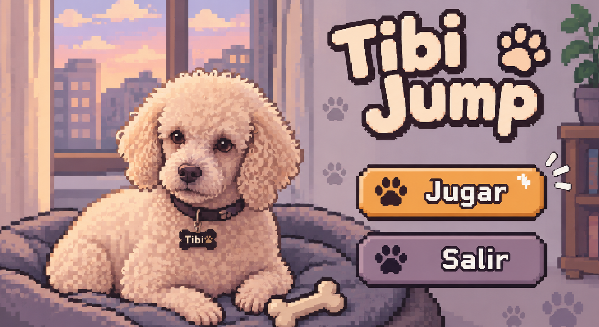
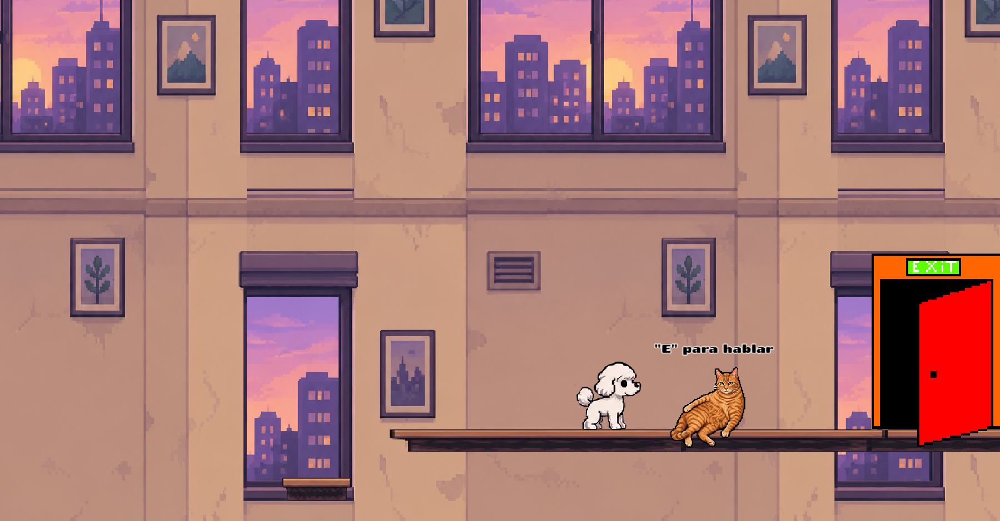
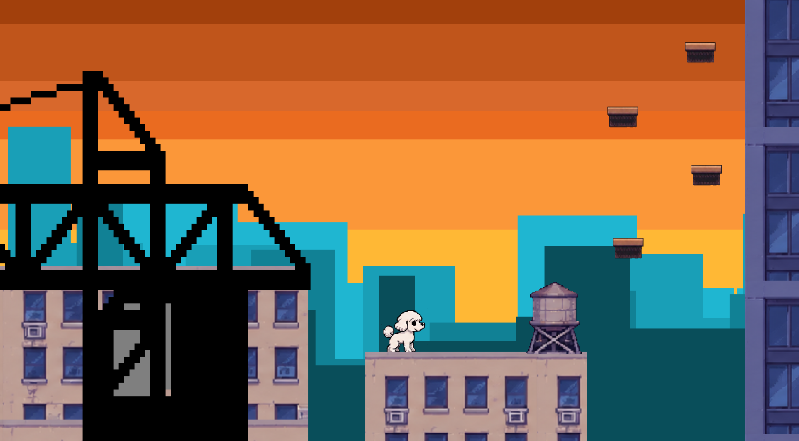

# 🐩 Tibi Jump

**Tibi Jump** es un videojuego de plataformas en 2D con estilo pixel art, protagonizado por Tibi, un pequeño perro que queda atrapado dentro de sus propios sueños.

## 🌙 Historia

Después de mudarse a un nuevo departamento con sus dueños, Tibi se queda dormido en su camita. Sin embargo, mientras duerme, comienza a vivir una aventura dentro de un extraño mundo de sueños.

Ahora se encuentra atrapado y deberá superar diferentes plataformas, obstáculos y desafíos para encontrar la salida y conseguir despertar, porque lo único que quiere es volver a estar con sus dueños.

¿Podrá Tibi escapar de sus sueños?

## 🎮 Controles

Los controles del juego son sencillos:

| Tecla | Acción |
|:---:|---|
| **A** | Moverse hacia la izquierda |
| **D** | Moverse hacia la derecha |
| **ESPACIO** | Saltar |

**Consejo:** administra bien tus saltos y calcula tus movimientos para alcanzar las plataformas más altas.

## 🖼️ Capturas del juego

### Menú principal

### Escena inicial

### Gameplay

### Personajes y escenarios

## 🛠️ Desarrollo

- **Motor de desarrollo:** GDevelop.
- **Género:** Plataformas 2D.
- **Estilo visual:** Pixel Art.
- **Protagonista:** Tibi.
- **Plataforma:** PC.

## 🚀 Objetivo

Superar los desafíos del mundo de los sueños, avanzar por las plataformas y ayudar a Tibi a encontrar el camino de regreso con sus dueños.

---

*Un pequeño perro, un gran sueño y una aventura para volver a casa. 🐾*
